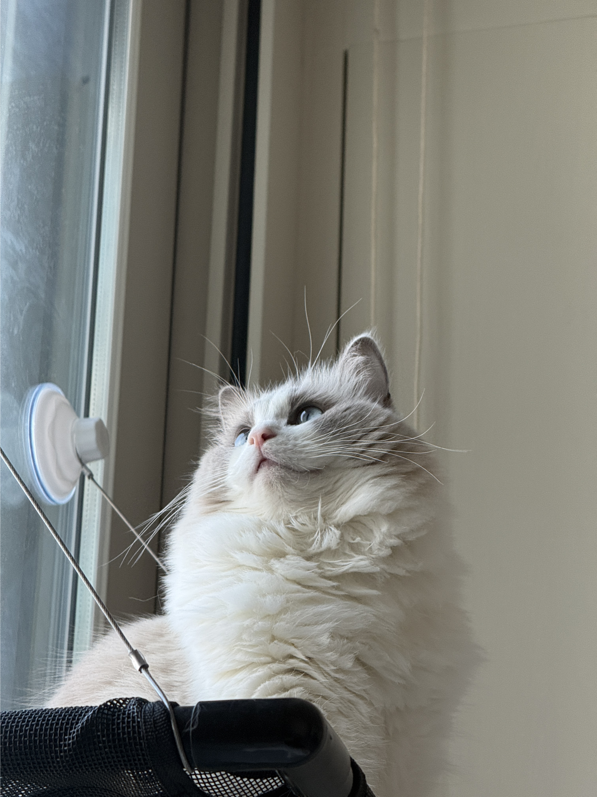

<!--
  이 주석은 화면에 보이지 않습니다. 다 읽었으면 지워도 됩니다. 자세한 방법은 GUIDE.md를 참고하세요.
  제목·요약·날짜·태그는 같은 폴더의 info.md에 적습니다. 이 파일에는 글만 씁니다.

  사진: Ctrl+V로 붙여 넣거나 Shift를 누른 채 끌어다 놓으면 사진이 이 폴더에 저장되고 아래 같은 줄이 들어갑니다.
    
  큰 PNG 사진은 커밋할 때 JPG로 자동으로 바뀝니다.

  사진 여러 장을 격자로 놓거나(Gallery) 동영상(Video)을 넣으려면 이 파일 이름을 index.mdx로 바꿉니다.
-->

귀염고양이