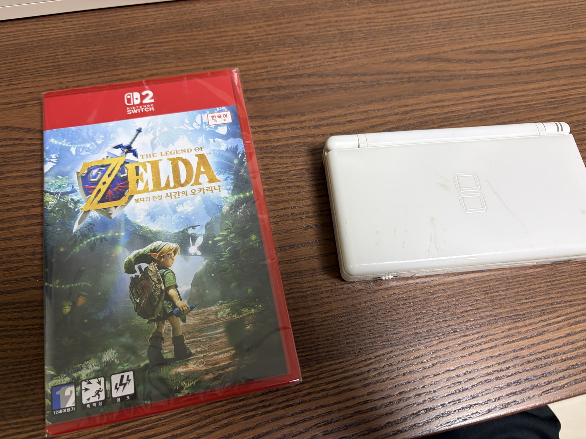
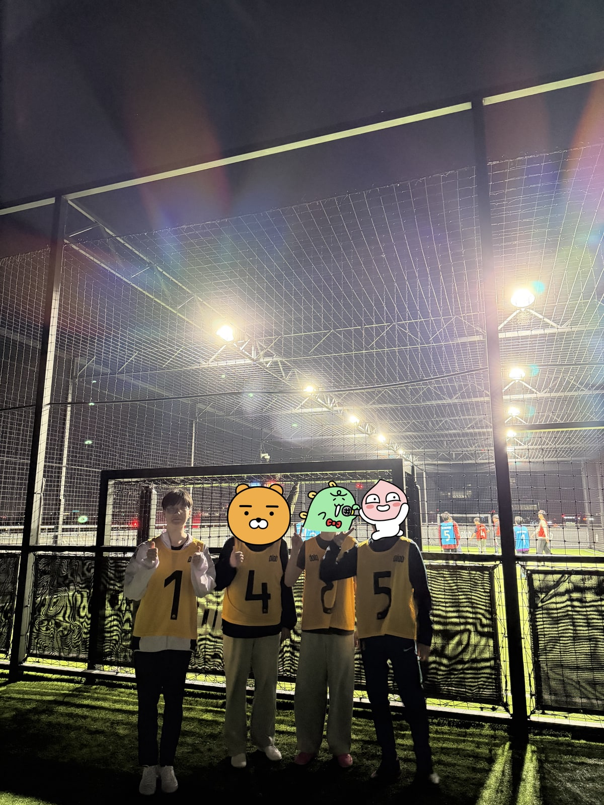

<!--
  이 주석은 화면에 보이지 않습니다. 다 읽었으면 지워도 됩니다. 자세한 방법은 GUIDE.md를 참고하세요.
  제목·요약·날짜·태그는 같은 폴더의 info.md에 적습니다. 이 파일에는 글만 씁니다.

  사진: Ctrl+V로 붙여 넣거나 Shift를 누른 채 끌어다 놓으면 사진이 이 폴더에 저장되고 아래 같은 줄이 들어갑니다.
    
  큰 사진은 커밋할 때 자동으로 줄어듭니다 (PNG는 JPG로, 촬영 위치 정보는 지워짐).

  사진 여러 장을 격자로 놓거나(Gallery) 동영상(Video)을 넣으려면 이 파일 이름을 index.mdx로 바꿉니다.
-->

실험실 사람들이랑 축구하러 가기로 해서 플랩에서 (어렵게) 예약해서 갔다

가산디지털단지 근처에서 했는데 알고보니까 여기 닌텐도 ds 수리점이 있다고 해서 먼저 가서 수리도 했다. 
옛날부터 해야지 해야지 하면서 미뤘는데 이번에 해서 속이뻥~

갔는데 스위치2 시간의 오카리나 게임팩이 보여서 이것도 같이 샀다.

게임팩 사면 오카리나도 준다길래 받을까했는데, 거추장스러워서 거절... 선생님이 친절해서 다음에도 사러 여기로 와야겠다 (구경할 때는 눈치 안 주고, 물어보는 것만 딱 대답해주시고, 구매강요 안하는 따봉사장님)

저번주에 이어서 이번주에 2번째 축구를 했는데

내 실력이 진짜 처참하게 7H못한다...
저번주에는 오랜만에 해서 그런가~? 했는데 이번에 하면서 그냥 몸이 옛날같지 않다는 걸 깨달았다.

그동안 축구 짱 잘한다고 큰소리 뻥뻥 쳤는데!!!
축구냥이가 되어버림

쩝쩝... 그래도 오랜만에 하니까 생기넘쳐서 좋았다.

## 아니 옛날에는 진짜 잘했다고!!