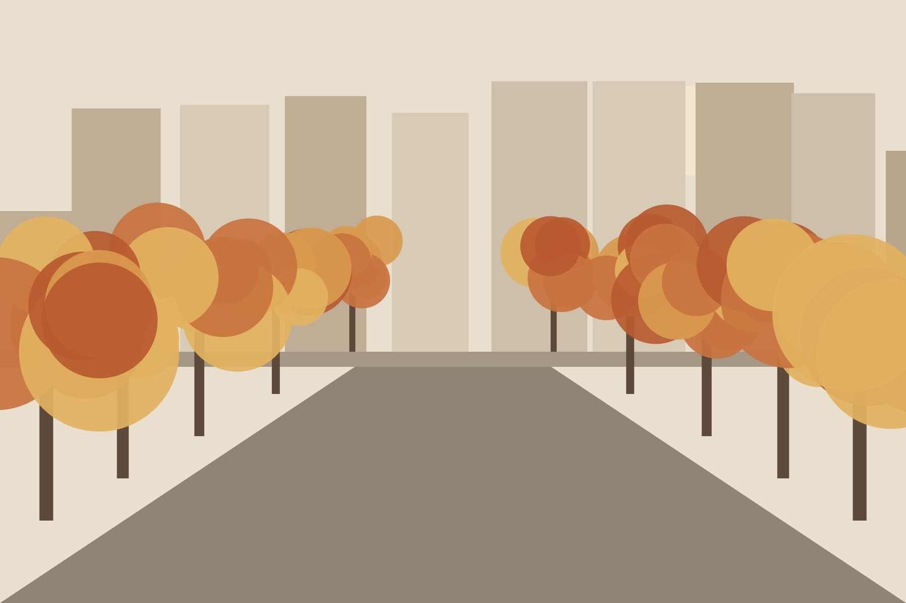
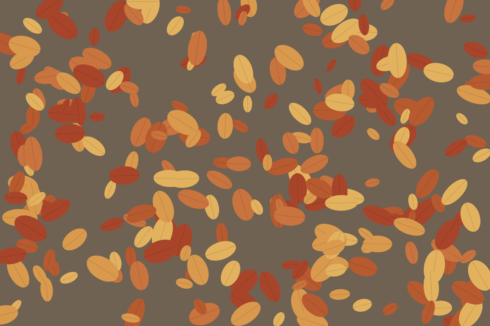

import walk from './walk.mp4';
import walkPoster from './walk-poster.jpg';

<Callout>
사진과 동영상을 글 중간에 넣는 방법을 보여 주는 **예시 글**입니다. 사진 한 장은 Markdown 한 줄로, 여러 장은 `<Gallery>`로, 동영상은 `<Video>`로 넣었습니다. 사진은 파일을 폴더에 넣기만 하면 되고, 동영상은 글 맨 위에서 `import`도 해야 합니다.
</Callout>

점심을 먹고 나니 볕이 좋아서 동네를 한 바퀴 걷기로 했다. 이번 주가 지나면 잎이 다 떨어질 것 같았다.

## 공원까지

큰길을 따라 십 분쯤 걸으면 작은 공원이 나온다. 가는 길 내내 발밑에 낙엽이 깔려 있어서 걸을 때마다 바스락 소리가 났다.

<Gallery caption="같은 길, 다른 색. 왼쪽은 단풍나무, 오른쪽은 은행나무 아래." columns={2}>

</Gallery>

바람이 불 때마다 잎이 조금씩 흩날렸다. 사진에는 잘 담기지 않아서 짧게 영상으로 남겨 두었다.

{/* 용량이 큰 영상은 파일 대신 YouTube에 올리고 <YouTube id="영상ID" title="영상 제목" />으로 넣는다. */}

<Video src={walk} poster={walkPoster} caption="바람 부는 낙엽길. (예시 영상)" />

## 벤치에서

공원 벤치에 앉아 한참을 있었다. 따뜻한 음료라도 하나 사 올 걸 그랬다.

돌아오는 길에는 해가 벌써 기울고 있었다. 짧은 산책이었지만 오후가 꽉 찬 느낌이었다.
