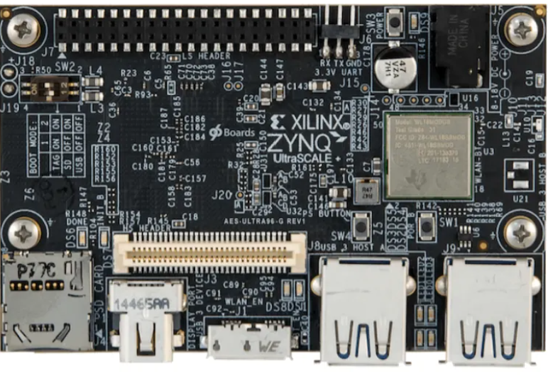
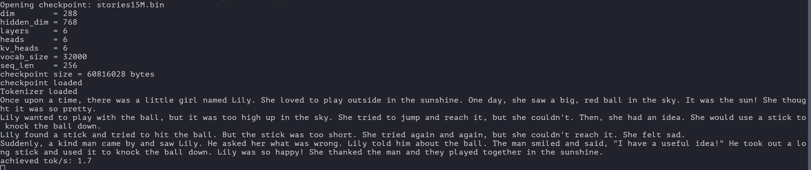
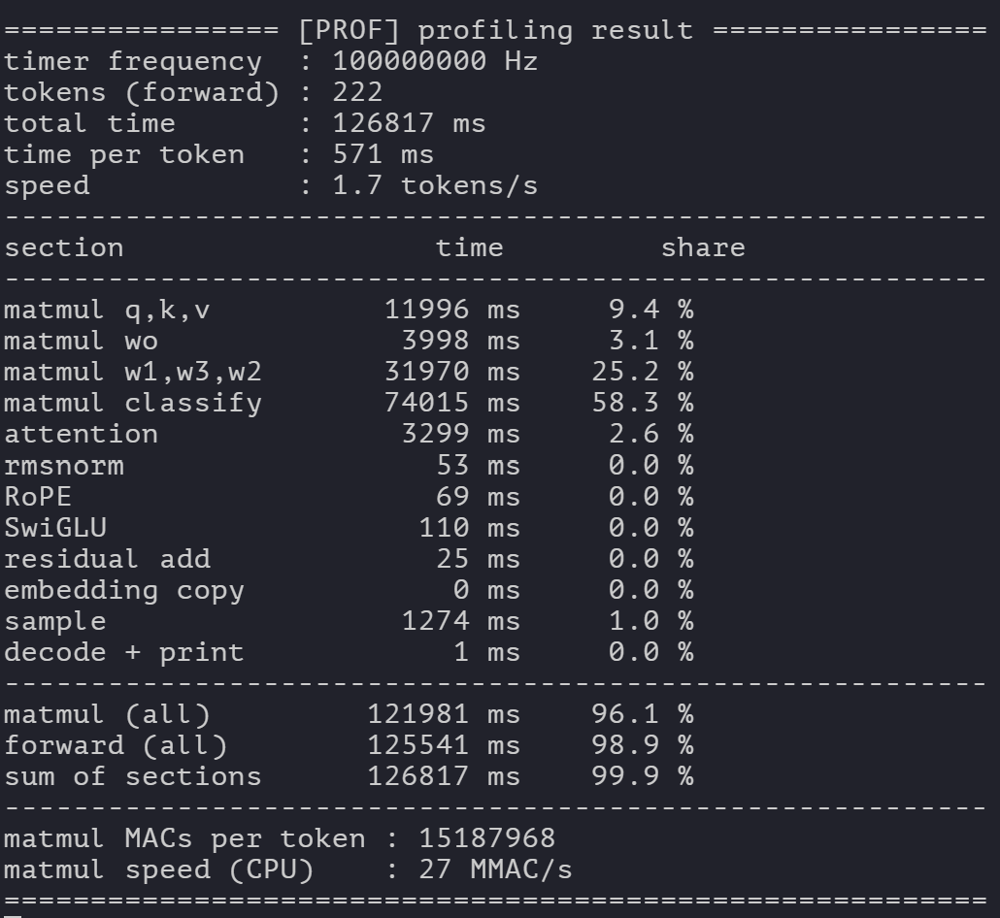

마이크로프로세서 수업에서 하는 term project인 LLM 을 zynq ultrascale 96의 ARM processor를 baseline으로 PL section을 이용해 가속하는 내용이에요.

### Zynq Ultra96 
Avnet이 개발한 소형 개발 보드로 ARM CPU와 FPGA가 하나의 칩에 들어간 Xilinx Zynq Ultrascale+ 를 탑재한 소형보드이다.

가격은 검색해보니 50만원(헉!). 수업을 진행하시는 교수님이 실험실별로 하나씩 나눠줬다.

사진은 이렇다. 



### llama2.c
우리가 가속하는 대상이다. 카파시라고 엄청 유명한 사람의 깃허브에 올라와있다. 작은 llama2 inference 과정을 c코드로 CPU에서 그대로 돌릴 수 있다.
아래가 링크.
https://github.com/karpathy/llama2.c


### baseline
SD 카드를 통해서 github에 있는 파일들을 몽땅 올리고 몇가지 무척 복잡한 과정을 하면 돌아가서 token을 생성하는 것을 직접 볼 수 있다.

교수님의 pdf 파일과 claude의 도움을 받아가면서 뚝딱뚝딱 겨우겨우 해냈다.



근데 막상 보면 제일 아래에 초당 1.7 토큰을 생성한다는 것을 볼 수 있다. 실제로 위에 문장들이 토큰을 만들어내는 과정에서 출력한 것인데, 진짜 복장 터지게 느리다.

심지어 이건 stories15M이라는 1500만개의 파라미터로 구성된 모델이고, stories42M이라는 4200만개의 파라미터로 구성된 모델은 초당 0.6 토큰으로 뭔가 단단히 잘못된 것을 알 수 있다.

그래서 이걸 zynq ultra scale의 PL section에 가속기를 만들어서 토큰 생성 속도를 빠르게 만드는 것이 프로젝트의 목표다.


### profiling
어떤 시스템을 빠르게 만들기로 결심했으면, 그 시스템의 <u>어디</u>를 빠르게 만들지 결정하는 것이 중요하다.

예를 들어, 총 100초(작업 A 10초 + 작업 B 90초)가 걸리는 시스템에서는,
10초짜리 작업을 10배 개선해 1초로 줄이는 것(총 91초)보다 
90초짜리 작업을 10배 개선해 9초로 줄이는 것(총 19초)이 훨씬 중요하다.

그렇기 때문에 토큰 한개를 만들 때 연산별로 걸리는 시간이 얼마인지를 측정하고자했다. 일단 c 코드를 보았을 때 쓰는 연산은 다음과 같다.
- matrix multiplication
- attention
- rmsnorm
- RoPE, SwiGLU, residual
- sample
- embedding copy
- decode + print

profiling을 위해서 기존의 c 코드에 timer를 각 연산 구간별로 넣어서 합산했다. 결과는 다음과 같다.


일단 마지막 section 을 보면 1개의 토큰을 만들 때 약 15M 개의 MAC 연산을 한다는 것과 CPU는 1초에 27M 개의 MAC 연산을 할 수 있다는 결과가 있다.

이를 통해서 보자면
<Callout>연산기의 초당 MAC 처리수 / 토큰당 MAC 연산 갯수 = 27M / 15M = 1.8 tok/s </Callout>
임을 알 수 있다. 1.7 tok/s 와 대강 맞는 수치

그리고 가운데 section을 보면 matrix multiplication이 전체 연산 시간의 96.1%나 차지하는 것을 알 수 있다. 
결국에는 matrix multiplication 만 최적화하더라도, 전체 시스템의 96.1%를 최적화하는 셈이다.


### matrix multiply & accumulation (MAC)
따라서 지금 우리가 하는 matmul이 뭔지 한 번 봐봐야 한다.

```c
void matmul(float* xout, float* x, float* w, int n, int d) {
    // W (d,n) @ x (n,) -> xout (d,)
    // by far the most amount of time is spent inside this little function
    int i;
    prof_macs += (unsigned long long)n * d;   // [PROF] count multiply-accumulates
    #pragma omp parallel for private(i)
    for (i = 0; i < d; i++) {
        float val = 0.0f;
        for (int j = 0; j < n; j++) {
            val += w[i * n + j] * x[j];
        }
        xout[i] = val;
    }
}
```

이게 c 코드에서 해당 함수인데 parameter 부터 보면
- xout : 결과를 저장할 곳 (d)
- x : 입력 vector (n)
- w : weigth matrix (d x n)
- n : 입력 길이 = 행렬의 row 갯수
- d : 출력 길이 = 행렬의 column 갯수
이다. 

그러니까 matrix(d x n) x vector(n) = output vector xout(d) 인 것이다.
이렇게 보편적인 matrix vector 곱을 하는 함수를 GEMV(GEneral Matrix Vector multiplciation) 이라고 한다.

이 GEMV 함수를 호출하는 곳과 그 특징은 다음과 같다.
| 호출 | 결과 ← 입력 | n (입력) | d (출력) | layer당 |
|---|---|---|---|---|
| `matmul(s->q, s->xb, wq…, dim, dim)` | q ← xb | 288 | 288 | 1 |
| `matmul(s->k, s->xb, wk…, dim, kv_dim)` | k ← xb | 288 | 288 | 1 |
| `matmul(s->v, s->xb, wv…, dim, kv_dim)` | v ← xb | 288 | 288 | 1 |
| `matmul(s->xb2, s->xb, wo…, dim, dim)` | xb2 ← xb | 288 | 288 | 1 |
| `matmul(s->hb, s->xb, w1…, dim, hidden_dim)` | hb ← xb | 288 | 768 | 1 |
| `matmul(s->hb2, s->xb, w3…, dim, hidden_dim)` | hb2 ← xb | 288 | 768 | 1 |
| `matmul(s->xb, s->hb, w2…, hidden_dim, dim)` | xb ← hb | 768 | 288 | 1 |
| `matmul(s->logits, x, w->wcls, dim, vocab)` | logits ← x | 288 | 32000 | 마지막 1번 |

참고로 마지막 classifier는 layer마다 도는 것이 아니라 마지막 한 번만 도는 것임에도 불구하고 아까전에 결과를 보면 전체 시간의 58%를 잡아먹는다.

아무튼 이 GEMV를 빠르게 돌릴 hardware를 PL section에 만들어볼 것이다. 이거는 다음 시간에~