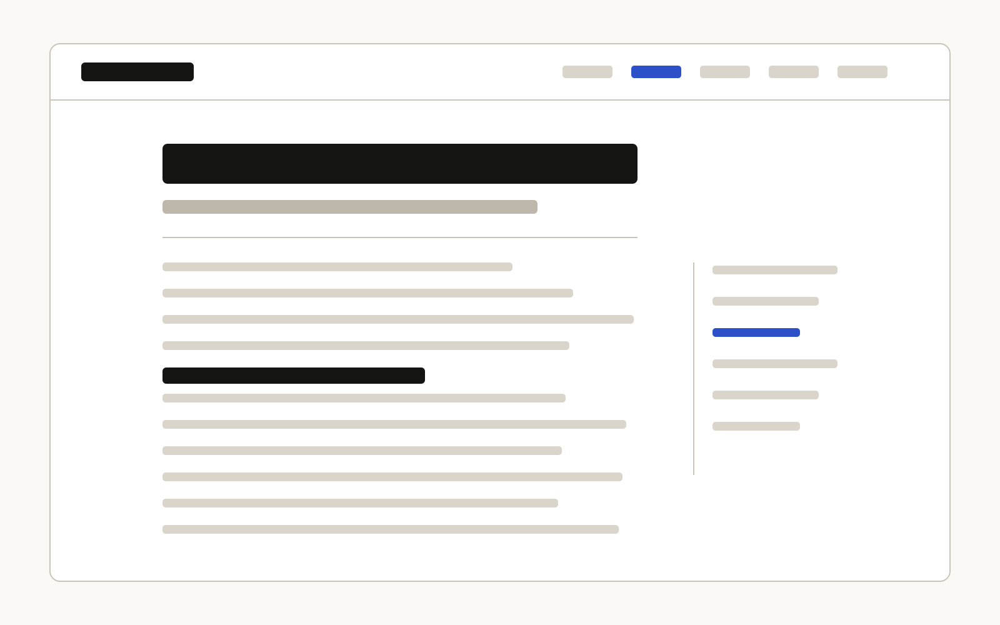

<Callout>
표, 코드, 인용, 강조 박스, 각주, 캡션이 달린 이미지가 실제로 어떻게 보이는지 보여 주는 **예시 글**입니다. 이 파일(`index.mdx`)을 열어 원문과 화면을 나란히 놓고 보면 쓰는 법을 금방 익힐 수 있습니다. 내 글을 쓰기 시작하면 이 폴더를 통째로 지워도 됩니다.
</Callout>

## 왜 처음부터 만들었나

잘 만든 테마는 많습니다. 하지만 남이 짠 구조 위에서 글을 쓰다 보면, 여백 하나를 고치려 해도 구조 전체를 먼저 이해해야 하는 순간이 옵니다. 그래서 이번에는 처음부터 직접 만들기로 했습니다. 목표는 두 가지였습니다. 필요한 것만 넣을 것, 그리고 제가 모르는 코드는 한 줄도 두지 않을 것.[^1]

덕분에 지금은 화면에 보이는 모든 것을 컴포넌트 몇 개와 스타일 파일 몇 개로 설명할 수 있습니다. 무엇이 어디서 오는지 안다는 것만으로도 글을 쓸 때 마음이 한결 편합니다.

## 도구 고르기

블로그를 만드는 방법 세 가지를 놓고 비교했습니다. 평가는 어디까지나 제 상황을 기준으로 했습니다.

| 항목 | 직접 만들기 | 기존 테마 사용 | 블로그 플랫폼 |
| --- | --- | --- | --- |
| 디자인 자유도 | 높음 | 중간 | 낮음 |
| 처음 만드는 데 드는 시간 | 오래 걸림 | 짧음 | 매우 짧음 |
| 유지보수 | 직접 | 테마 업데이트에 의존 | 플랫폼이 담당 |
| 비용[^2] | 무료 | 무료 | 무료 ~ 유료 |
| 글 옮기기 | 쉬움 (Markdown 파일) | 쉬움 (Markdown 파일) | 플랫폼마다 다름 |

### 비교해 보니

처음 만드는 데 드는 시간만 빼면 직접 만드는 쪽이 제게 맞았습니다. 특히 글이 Markdown 파일로 남는다는 점이 결정적이었습니다. 나중에 어떤 도구로 옮겨 가더라도 글만큼은 그대로 가져갈 수 있으니까요.

## 구조 잡기

먼저 글 페이지의 구성을 종이에 그려 보았습니다. 위에서부터 제목과 요약, 날짜와 태그 같은 정보, 본문이 차례로 오고, 화면이 넓을 때만 본문 오른쪽에 목차가 붙습니다.



### 글은 content collection으로

글은 Astro의 content collection으로 관리합니다. 글 맨 위의 정보(frontmatter) 형식을 미리 정해 두었기 때문에, 제목이나 날짜처럼 꼭 필요한 항목을 빠뜨리면 빌드할 때 바로 알려 줍니다.

```ts
// src/content.config.ts (간추림)
const posts = defineCollection({
  loader: glob({ pattern: '**/*.{md,mdx}', base: './src/content/posts' }),
  schema: ({ image }) =>
    z.object({
      title: z.string(),
      description: z.string(),
      date: z.coerce.date(),
      category: z.enum(['daily', 'tech']),
      tags: z.array(z.string()).default([]),
      toc: z.boolean().default(true),
      cover: image().optional(),
      draft: z.boolean().default(false),
    }),
});
```

### 글 하나에 폴더 하나

글마다 폴더를 하나씩 만들고, 폴더 이름을 그대로 주소로 씁니다. 사진과 동영상도 같은 폴더에 두기 때문에 글을 옮기거나 지울 때는 폴더 하나만 다루면 됩니다.

```text
src/content/posts/tech/building-this-blog/
├── index.mdx          → /posts/building-this-blog/
├── cover.jpg
└── layout-sketch.png
```

## 디자인 원칙

색은 배경, 글자, 선, 그리고 강조색 하나만 씁니다. 그림자나 장식 없이 얇은 선과 여백만으로 영역을 나눕니다.

<Quote name="이예시" role="예시 스튜디오 · 디자이너 (가상 인물)">
좋은 읽기 화면은 무엇을 더할지가 아니라 무엇을 덜어낼지에서 시작합니다. 남은 것들이 제자리에 있으면 장식은 필요 없습니다.
</Quote>

## 배포

GitHub 저장소에 올리면 GitHub Actions가 사이트를 빌드해서 GitHub Pages에 배포합니다. 글을 고칠 때도 파일을 고쳐 올리기만 하면 됩니다.

<Callout type="warning" title="배포 전에 꼭 확인하세요">
`astro.config.mjs`의 `site` 값이 실제 주소와 다르면 RSS, 사이트맵, 공유 미리보기에 들어가는 주소가 모두 잘못 만들어집니다.
</Callout>

## 마치며

처음 만드는 데는 시간이 걸렸지만, 이제는 글 쓰는 일에만 집중할 수 있습니다. 한글 본문을 읽기 좋게 만드는 CSS 설정은 [지난 글](/posts/korean-typography-css/)에 따로 정리해 두었습니다.

[^1]: 물론 Astro 자체나 글꼴 같은 외부 패키지는 예외입니다. 여기서 말하는 것은 직접 쓴 코드입니다.
[^2]: GitHub Pages는 공개 저장소라면 무료입니다. 개인 도메인을 연결하면 도메인 비용이 따로 듭니다.
